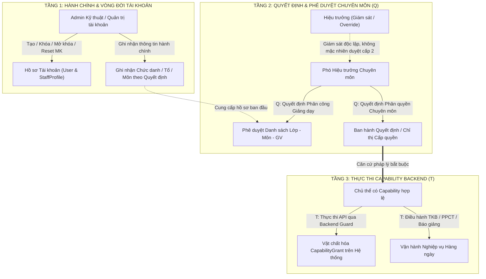
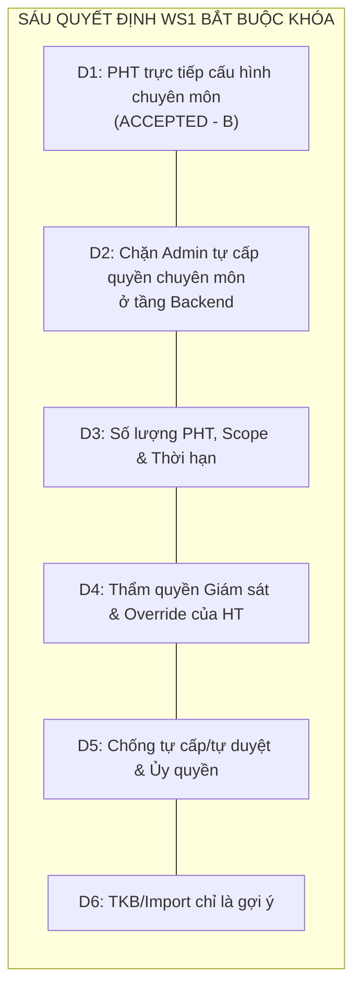
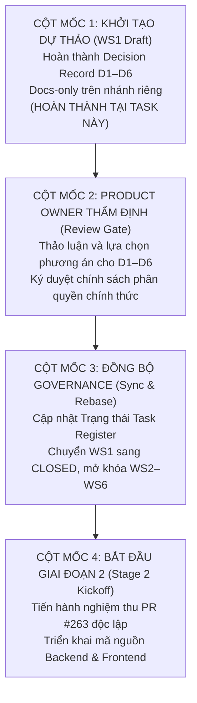
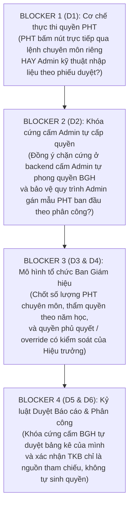

# P5-057 / WS1 — Bản ghi Quyết định Thẩm quyền Chuyên môn và Mô hình Phân quyền (DỰ THẢO)

**Mã tài liệu:** `P5-057-WS1-ACADEMIC-AUTHORITY-DECISION-RECORD-DRAFT`
**Trạng thái:** **TECHNICAL BASELINE READY / NON-NORMATIVE** — D1 accepted, D3/D4 partially accepted; implementation choices D2/D5/D6 documented, policy sign-off still required before permission changes.
**Ngày lập dự thảo:** 05/11/2026
**Quyết định Product Owner:** D1 = PHƯƠNG ÁN B (ACCEPTED 05/11/2026); D3 PARTIAL ACCEPTED (05/11/2026); **D4 PARTIAL ACCEPTED (06/11/2026)** về giám sát độc lập và ngoại lệ khẩn cấp có kiểm soát. D2/D5/D6, chi tiết chuyển giao/thu hồi D3 và quy trình can thiệp khẩn cấp D4 vẫn OPEN; chưa cho phép thay đổi backend, schema, quyền thật hoặc deploy.
**Phạm vi áp dụng:** Gói công việc 1 (WS1 — Khóa nghiệp vụ thẩm quyền chuyên môn) thuộc nhiệm vụ `P5-057` (Traceability: `T56`).
**Nhánh Git công tác:** `docs/p5-057-four-stage-realignment` (PR #264; code baseline `bd79173a1180c26cbd33555ff081c015ef515bff`).
**Ranh giới kỹ thuật:** **TÀI LIỆU DUY NHẤT ĐƯỢC TẠO — DOCS-ONLY**. Tuyệt đối không thay đổi mã nguồn backend, frontend, schema cơ sở dữ liệu, Prisma migration, test suite, file khóa phụ thuộc, cấu hình Git, VPS, hệ thống Quản lí Nội trú hay cơ sở dữ liệu production.

> **Lưu ý kiểm chứng:** Tên endpoint API, trường chứng từ phê duyệt, mã lỗi, thời hạn hiệu lực và luồng kiểm thử trong bản ADR là **đề xuất thiết kế**, trừ khi có đường dẫn mã nguồn được đối chiếu rõ ràng. Không coi các ví dụ là tính năng backend đã có, không tự động lựa chọn D1–D6 hay khẳng định schema không cần thay đổi.

> [!IMPORTANT]
> **Tuyên bố Thẩm quyền & Giới hạn Pháp lý:**
> Tài liệu này được lập ra nhằm mục đích phân tích thiết kế kiến trúc và chuẩn bị cơ sở pháp lý nghiệp vụ cho Product Owner thẩm định, giải quyết điểm mâu thuẫn cốt lõi giữa vai trò "Admin kỹ thuật" và "Phó Hiệu trưởng (PHT) chuyên môn".
> Bản dự thảo này:
> 1. **KHÔNG** làm thay đổi chính sách phân quyền backend hiện hành trên hệ thống;
> 2. **KHÔNG** tự ý cấp/thu hồi bất kỳ capability thực tế nào trong cơ sở dữ liệu;
> 3. **KHÔNG** tự ý chuyển trạng thái hoặc đóng task WS1 hay `P5-057` trong `PRE-PILOT-TASK-REGISTER.md`;
> 4. **KHÔNG** làm thay đổi ranh giới hay gộp phạm vi của PR #263 (đang độc lập) và các gói công việc tương lai WS2–WS8.

---

## 1. Bảng Nguồn Tham chiếu và Chứng cứ Khảo sát Thực tế

Bảng đối chiếu dưới đây liệt kê toàn bộ các căn cứ thẩm quyền và chứng cứ mã nguồn hiện có trong repository `D:\baogiang-damsan`, phân định rõ ràng giữa **Đã xác minh trực tiếp** và **Cần xác minh / Quy nạp qua governance**.

### 1.1 Bảng chứng cứ khảo sát

| STT | Tài liệu / Mã nguồn / Biểu tượng | Đường dẫn tập tin (Path) | Tình trạng kiểm chứng | Ý nghĩa nghiệp vụ & Bằng chứng thực tế |
| :--- | :--- | :--- | :--- | :--- |
| 1 | Kế hoạch 4 giai đoạn P5-057 | `docs/tasks/P5-057-FOUR-STAGE-OPERABILITY-EXECUTION-PLAN.md` | **Đã xác minh** | Khóa thứ tự 4 giai đoạn: Giai đoạn 1 (WS1 Khóa nghiệp vụ), Giai đoạn 2 (WS2–WS6 Quản trị), Giai đoạn 3 (WS7 UX), Giai đoạn 4 (WS8 Nghiệm thu E2E). WS1 là điều kiện tiên quyết. |
| 2 | Dự thảo ma trận thẩm quyền WS1 | `docs/requirements/P5-057-ACADEMIC-AUTHORITY-MATRIX-DRAFT.md` | **Đã xác minh** | Phân tách sơ bộ quyền Q (quyết định) và T (thực thi); liệt kê 6 vấn đề mở D1–D6 cần Product Owner phê duyệt dứt điểm. |
| 3 | Khung đóng băng persona E2E | `docs/requirements/P5-057-PERSONA-OPERABILITY-E2E-FREEZE.md` | **Đã xác minh** | Yêu cầu kiểm chứng đóng băng trên 7 persona thực tế; hành trình bắt buộc của PHT từ tạo tài khoản đến điều hành chuyên môn mà không lộ UUID/capability key. |
| 4 | Baseline sản phẩm tiền Pilot | `docs/governance/PRE-PILOT-PRODUCT-BASELINE.md` | **Đã xác minh** | Nguyên tắc "REALIGN, NOT REBUILD", giữ vững backend default-deny, session xác thực máy chủ, lịch sử daterange `TeachingAssignment`, TKB, PPCT và Reporting Statement. |
| 5 | Ma trận truy vết tiền Pilot | `docs/governance/PRE-PILOT-TRACEABILITY-MATRIX.md` | **Đã xác minh** | Hàng `T56` (P5-057); các hàng nền tảng `T03` (TeachingAssignment), `T04` (TKB), `T05` (PPCT), `T18` (Coordinator GDĐP/HĐTN), `T50` (Baseline/Templates). |
| 6 | Sổ đăng ký công việc | `docs/governance/PRE-PILOT-TASK-REGISTER.md` | **Đã xác minh** | Nhiệm vụ `P5-057` đang ở trạng thái `IN_PROGRESS` (chỉ docs WS1); tiền đề bắt buộc trước khi mở cổng kiểm tra giáo viên `P6-050`. |
| 7 | Hiện trạng dự án | `docs/governance/CURRENT-PROJECT-STATUS.md` | **Đã xác minh** | Xác nhận 06/11/2026: PR #263 đã merge và deploy code-only (CI #891, VPS #33); UAT người dùng thật còn mở. |
| 8 | Phương án B v1.3 Addendum | `docs/specifications/PA-B-VPS-PostgreSQL-v1.3-IMPLEMENTATION-ADDENDUM.md` | **Đã xác minh** | Thẩm quyền cao nhất về hạ tầng VPS Windows Server 2022, PostgreSQL độc lập, phân tách môi trường local/CI/VPS và kỷ luật delivery. |
| 9 | Phương án B v1.2 Đặc tả nghiệp vụ | `docs/specifications/PA-B-VPS-PostgreSQL-v1.2-AI-governance.docx` (và các bản audit canonical) | **Đã xác minh** | Mục 2, 3, 14, 15: Nguyên tắc `TEACHER_BASE` là nền tảng; cộng dồn capability; Admin quản trị tài khoản; HT/PHT nộp bảng kê qua Tổ trưởng, không tự duyệt. |
| 10 | Danh mục Mẫu trách nhiệm | `apps/api/src/capabilities/responsibility-template-catalog.ts` | **Đã xác minh** | Định nghĩa 7 template: `TEACHER`, `SUBJECT_LEADER`, `VICE_PRINCIPAL_ACADEMIC`, `PRINCIPAL`, `GDDP_COORDINATOR`, `HDTN_COORDINATOR`, `TECHNICAL_ACCOUNT_ADMIN`. PHT có các quyền nghiệp vụ `SCHOOL_WIDE` nhưng thuộc tính `forbiddenDefaults` cấm `CAPABILITY_GRANT`, `USER_MANAGE`, `SYSTEM_ADMIN`. |
| 11 | Controller Mẫu trách nhiệm | `apps/api/src/capabilities/responsibility-templates.controller.ts` | **Đã xác minh** | Toàn bộ controller được bảo vệ bởi `@RequireCapability('CAPABILITY_GRANT', { scope: 'SCHOOL_WIDE' })`. Do đó PHT hiện không thể truy cập các endpoint apply/preview template. |
| 12 | Controller Capabilities | `apps/api/src/capabilities/capabilities.controller.ts` | **Đã xác minh** | Toàn bộ controller được bảo vệ bởi `@RequireCapability('CAPABILITY_GRANT', { scope: 'SCHOOL_WIDE' })`. Chỉ Technical Admin hiện có quyền gọi cấp phát capability. |
| 13 | Service Cấp phát Capability | `apps/api/src/capabilities/capabilities.service.ts` | **Đã xác minh** | Hàm `create()` và `revoke()` ghi audit log `CAPABILITY_GRANTED`/`CAPABILITY_REVOKED`, nhưng hiện tại KHÔNG có kiểm tra chống tự cấp quyền (self-grant check) ở tầng backend nếu người dùng có capability này. |
| 14 | Service Nền tảng Truy cập | `apps/api/src/capabilities/access-baseline.service.ts` | **Đã xác minh** | Hàm `isEligibleForProfessionalBaseline()` chuẩn tắc: chỉ cấp `TEACHER_BASE` khi `status === ACTIVE` và `profile.isTeachingStaff === true`. |
| 15 | Bộ đánh giá quyền hạn | `apps/api/src/authorization/capability-authorization.service.ts` | **Đã xác minh** | Đánh giá default-deny, khớp scope thứ bậc (`SCHOOL_WIDE` bao trùm scope hẹp), kiểm tra hiệu lực thời gian `validFrom` - `validUntil` và cờ thu hồi `revokedAt`. |
| 16 | Bộ bảo vệ CSRF | `apps/api/src/auth/csrf-origin.guard.ts` | **Đã xác minh** | Bắt buộc kiểm tra origin/referer hợp lệ trên mọi request thay đổi trạng thái (POST/PUT/DELETE/PATCH). |
| 17 | ADR-008 (Default-Deny Authorization) | Trích dẫn trong `PRE-PILOT-PRODUCT-BASELINE.md` §3, §4; `TRACEABILITY-MATRIX` T18 | **Cần xác minh / Quy nạp qua governance** | Quyết định nền tảng về kiểm soát truy cập dựa trên capability/scope, phủ định mặc định. Lưu vết trong commit lịch sử P0/v1.3, không có file đơn lẻ `ADR-008.md` trong `docs/decisions/`. |
| 18 | ADR-012/013/014 (Teaching Assignment & TKB History) | Trích dẫn trong `PRE-PILOT-PRODUCT-BASELINE.md` §3; `TRACEABILITY-MATRIX` T03, T04 | **Cần xác minh / Quy nạp qua governance** | Quyết định bảo toàn lịch sử phân công giảng dạy, không cho phép co-teaching ngầm tại một thời điểm, bảo toàn phiên bản TKB. Lưu vết trong commit lịch sử P0/v1.3. |
| 19 | ADR-044 (Traceability Matrix Authority) | Trích dẫn trong `PRE-PILOT-TRACEABILITY-MATRIX.md` L7 | **Cần xác minh / Quy nạp qua governance** | Chuẩn hóa ma trận truy vết tiền pilot qua task P0-001. Lưu vết trong commit PR #91. |
| 20 | Chỉ đạo Product Owner 01/11/2026 | Biên bản trao đổi chỉ đạo nghiệp vụ ngày 01/11/2026 | **Đã xác minh qua hồ sơ task** | Chỉ đạo chiến lược: "PHT là admin nghiệp vụ, mọi quyết định phân quyền chuyên môn thuộc PHT; Admin quản lý tài khoản kỹ thuật". |

---

### 1.2 Bảng so sánh khác biệt chính sách (Policy Diff Matrix)

Bảng dưới đây chỉ rõ sự khác biệt giữa thiết kế trong tài liệu này so với Đặc tả v1.2, Addendum v1.3 và cơ chế hiện hành của ADR-008:

| Chiều chính sách | Đặc tả gốc Phương án B v1.2 | Addendum v1.3 & ADR-008 | Hiện trạng Code triển khai thực tế | Đề xuất mới trong Dự thảo WS1 (Chờ PO duyệt) |
| :--- | :--- | :--- | :--- | :--- |
| **Nền tảng quyền hạn của Nhân sự** | `TEACHER_BASE` là quyền nền tảng cho mọi nhân sự sư phạm (kể cả HT/PHT). | Khẳng định `TEACHER_BASE` là capability độc lập, kết hợp scope `PERSONAL`, backend từ chối mặc định. | `AccessBaselineService` tự động kiểm tra `isTeachingStaff === true` và cấp `TEACHER_BASE/PERSONAL`. | **Giữ nguyên:** Bảo lưu 100% nguyên tắc `TEACHER_BASE/PERSONAL` cho mọi chức danh sư phạm. Không ngoại lệ. |
| **Cơ sở xác định quyền hạn API** | Chức danh, vị trí công tác và phân công kiêm nhiệm là cơ sở xác định quyền. | Tuyệt đối không suy diễn quyền API từ chuỗi danh xưng hay chức danh. Quyền phải được vật chất hóa thành capability grant. | Capability grant cụ thể trong bảng `CapabilityGrant`. `responsibility-template-catalog.ts` cung cấp mẫu trách nhiệm. | **Giữ nguyên & Làm rõ:** Chức danh trong hồ sơ chỉ là dữ liệu hành chính/hiển thị. Quyền thực thi API bắt buộc phải qua capability grant hợp lệ. |
| **Vai trò của Admin kỹ thuật** | Admin tài khoản tạo người dùng, gán tổ, môn, chức vụ và vai trò kiêm nhiệm (Mục 14.1). | Admin sở hữu capability kỹ thuật để duy trì vòng đời hệ thống. | Admin có `USER_MANAGE` và `CAPABILITY_GRANT/SCHOOL_WIDE`, có thể gán mọi quyền cho bất kỳ ai. | **Thu hẹp nghiêm ngặt:** Admin chỉ quản lý tài khoản kỹ thuật (tạo, kích hoạt, khóa, reset mật khẩu). Admin **KHÔNG ĐƯỢC** tự ý quyết định hay tự cấp quyền chuyên môn. |
| **Vai trò của Phó Hiệu trưởng (PHT)** | PHT là cán bộ quản lý chuyên môn, thực hiện phân công và duyệt báo cáo. | PHT có các capability nghiệp vụ chuyên môn; không được cấp quyền kỹ thuật hệ thống. | Template `VICE_PRINCIPAL_ACADEMIC` có quyền nghiệp vụ nhưng bị cấm `CAPABILITY_GRANT` nên bị Controller chặn truy cập UI gán quyền. | **Nâng thành Thẩm quyền Quyết định Chuyên môn:** PHT là người duy nhất phê duyệt hoặc ban hành phân quyền chuyên môn. Giải quyết tắc nghẽn UI bằng command chuyên môn hẹp (D1). |
| **Cấp phát quyền hạn (Granting Authority)** | Không quy định cơ chế kỹ thuật chi tiết của việc gán quyền. | Generic `CAPABILITY_GRANT/SCHOOL_WIDE` quản lý toàn bộ việc cấp/thu hồi mọi capability. | Một capability duy nhất `CAPABILITY_GRANT` dùng chung cho cả quyền kỹ thuật và quyền chuyên môn. | **Phân tách ranh giới (D1, D2):** Đề xuất tách biệt hoặc đặt chốt chặn backend để Admin không dùng `CAPABILITY_GRANT` tự chiếm quyền chuyên môn và PHT không nhận generic technical grant. |
| **Quy trình Phê duyệt Báo cáo Kê khai** | HT và PHT gửi bảng kê tiết dạy cá nhân qua Tổ trưởng chuyên môn thẩm định, không tự duyệt (Mục 3.4). | Bảo vệ logic nghiệp vụ, cấm tự phê duyệt (anti-self-approval). | Backend `ReportingStatementsService.decide()` đã chặn người tự duyệt bản kê bằng so sánh `submitterUserId === actor`, có integration test cho cả duyệt/từ chối; tuyến thẩm định TTCM cho BGH còn cần làm rõ. | **Giữ chức năng D5 đã có:** không viết lại kiểm tra chống tự duyệt; làm rõ tuyến TTCM thẩm định BGH và xây kiểm soát anti-self-grant tại grant writer. |
| **Nguồn dữ liệu Phân công (TKB/PPCT)** | Dữ liệu nhập từ TKB và phân công của trường là căn cứ điều hành. | Importer chuẩn hóa dữ liệu, lưu vết lịch sử không ghi đè, preview trước khi ghi. | Importer TKB native Đam San (`P2-040`/`P2-050`) ghi nhận các tiết học và marker đặc thù. | **Phân định rõ ràng (D6):** TKB nhập vào chỉ là nguồn **gợi ý (suggestion)**, tuyệt đối không tự động sinh quyền hay thay thế quyết định chuyên môn của PHT. |

---

## 2. Phân định Ba Tầng Thao tác và Mô hình RACI Persona

Nhằm loại bỏ hoàn toàn sự nhập nhằng giữa thao tác kỹ thuật và quyết định quản lý trường học, hệ thống thiết lập mô hình phân tách 3 tầng độc lập:

### 2.1 Định nghĩa các tầng thao tác
1. **Tầng 1 — Tạo/cập nhật hồ sơ và ghi nhận kỹ thuật (Admin tài khoản):**
   Chịu trách nhiệm về trạng thái hoạt động của tài khoản (`User.status`), hồ sơ nhân viên (`StaffProfile`), gán thông tin hiển thị (tổ, môn, chức danh) theo văn bản điều động của nhà trường. Thao tác này **chỉ mang tính chất ghi nhận hành chính**, không tự động sản sinh bất kỳ quyền thao tác nghiệp vụ nào trên API.
2. **Tầng 2 — Quyết định và phê duyệt chuyên môn (Người Q — PHT / HT):**
   Chịu trách nhiệm ra quyết định ai dạy lớp nào, môn nào, ai làm tổ trưởng, ai điều phối chương trình đặc thù và phạm vi thời gian hiệu lực. Đây là thẩm quyền sư phạm độc quyền của Ban Giám hiệu, không phụ thuộc vào công cụ tin học.
3. **Tầng 3 — Thực thi capability backend (Người T — Actor có thẩm quyền):**
   Thao tác gọi trực tiếp vào các endpoint backend được bảo vệ bởi `CapabilityGuard` và `CsrfOriginGuard` để ghi nhận dữ liệu vào cơ sở dữ liệu. Thao tác này chỉ hợp lệ khi có capability phù hợp và phải gắn liền với vết kiểm toán (audit trail) chỉ rõ căn cứ quyết định từ Tầng 2.

---

### 2.2 Ma trận RACI Thẩm quyền theo Persona

*Giải thích thuật ngữ RACI:*
- **R (Responsible - Người thực hiện):** Người trực tiếp thao tác thực thi nghiệp vụ hoặc gọi API trên giao diện/backend.
- **A (Accountable - Người chịu trách nhiệm/Phê duyệt):** Người có thẩm quyền quyết định cao nhất, phê duyệt kết quả và chịu trách nhiệm pháp lý. Duy nhất 1 persona giữ vai trò A cho mỗi nghiệp vụ.
- **C (Consulted - Người được tham vấn):** Người đóng góp ý kiến chuyên môn, đề xuất danh sách trước khi quyết định được ban hành.
- **I (Informed - Người nhận thông tin):** Người được hệ thống thông báo kết quả (qua thông báo in-app / email / giao diện) sau khi thao tác hoàn tất.

| Nhóm nghiệp vụ / Tác vụ cụ thể | Admin Kỹ thuật | Phó Hiệu trưởng (PHT) | Hiệu trưởng (HT) | Tổ trưởng Chuyên môn (TTCM) | Giáo viên Bộ môn (GV) | Điều phối GDĐP / HĐTN |
| :--- | :---: | :---: | :---: | :---: | :---: | :---: |
| **1. Quản trị vòng đời tài khoản** | | | | | | |
| - Tạo tài khoản, kích hoạt, khóa, reset mật khẩu | **R / A** | I | I | I | I (nhận tài khoản) | — |
| - Xóa an toàn tài khoản trắng (Clean-slate delete) | **R** | C | **A** | — | — | — |
| - Ghi thông tin hành chính: Tổ, Môn, Chức danh | **R** | **A** | I | C (đề xuất tổ) | I | — |
| **2. Phân công nhiệm vụ giảng dạy** | | | | | | |
| - Lập kế hoạch phân công giáo viên dạy lớp-môn | I | **A** | I | **R** (đề xuất) | I (xem phân công) | — |
| - Phê duyệt / ban hành phân công giảng dạy chính thức | — | **R / A** | C (giám sát) | I | I | — |
| - Điều chỉnh phân công / thay đổi hiệu lực daterange | **—** (không cấu hình chuyên môn) | **R / A** | I | C (báo cáo) | I | — |
| **3. Cấp phát và quản lý Capability** | | | | | | |
| - Cấp/thu hồi quyền kỹ thuật (USER_MANAGE, AUDIT_VIEW) | **R** | — | **A** | — | — | — |
| - Cấp/thu hồi quyền chuyên môn qua Template (D1 Option B) | — | **R / A** | C (giám sát) | — | — | — |
| - Cấp/thu hồi quyền chuyên môn qua Admin (D1 Option A — ĐÃ LOẠI, chỉ lưu để truy vết) | **KHÔNG ÁP DỤNG** | **PHT tự thao tác theo B** | I | — | — | — |
| **4. Điều hành học thuật thường ngày** | | | | | | |
| - Cấu hình, nhập và ban hành Thời khóa biểu (TKB) chính thức | **—** (chỉ hỗ trợ kỹ thuật hệ thống) | **R / A** | I (giám sát) | C (đề xuất) | I (xem lịch) | I |
| - Nhập và ban hành Phân phối chương trình (PPCT) | — | **A** | I | **R** (kiểm tra/nộp) | I (xem bài học) | — |
| - Duyệt ngoại lệ lịch, tiết dạy bù, dạy thay | — | **A** | I | **R** (thẩm tra) | C (người dạy) | — |
| **5. Đánh giá và Phê duyệt báo cáo kê khai** | | | | | | |
| - Nộp bảng kê giảng dạy cá nhân (kể cả BGH) | — | **R** (bản thân) | **R** (bản thân) | **R** (bản thân) | **R** (bản thân) | **R** (bản thân) |
| - Thẩm định bảng kê của Giáo viên trong tổ | — | I | I | **R / A** | I | — |
| - Thẩm định bảng kê cá nhân của HT và PHT | — | — | — | **R / A** (đúng tổ) | — | — |
| - Phê duyệt báo cáo thống kê toàn trường cấp BGH | — | **R** | **A** | I | I | I |
| **6. Chương trình đặc thù (GDĐP, HĐTN-HN)** | | | | | | |
| - Cấu hình và quyết định kế hoạch chuyên đề, phân công slot | — | **R / A** | I | C | — | **C / R** (chuẩn bị đề xuất trong phạm vi) |
| - Phê duyệt kế hoạch chương trình đặc thù | — | **R / A** | C | — | — | I |
| - Xác nhận minh chứng tham gia (Attestation) | — | **R / A** (khi duyệt) | I | — | I (nhận tiết) | **R** (xác nhận đợt) |

---

## 3. Sáu quyết định — D1 accepted; D3/D4 partial; D2/D5/D6 có hợp đồng đề xuất

D1 đã được PO chốt phương án B; D3/D4 chốt một phần; PO xác nhận trường luôn có PHT chuyên môn. Các vấn đề phải quyết định bổ sung được định danh trong `docs/requirements/P5-057-WS1-TECHNICAL-BASELINE-20261106.md`. Hợp đồng triển khai là đề xuất kỹ thuật, chưa cấp quyền sửa backend hay đóng WS1.

---

### D1 — Cơ chế thực thi quyết định phân quyền chuyên môn của PHT

- **Trạng thái:** **ACCEPTED — PHƯƠNG ÁN B (Product Owner, 05/11/2026).** PHT trực tiếp quyết định và cấu hình mọi nghiệp vụ chuyên môn trong phạm vi phụ trách: phân công GV/môn/lớp, TKB, PPCT, ngoại lệ giảng dạy, mẫu quyền chuyên môn, GDĐP và HĐTN-HN. Admin chỉ quản lý tài khoản và hạ tầng kỹ thuật, không cấu hình chuyên môn thay PHT. Đây là quyết định mô hình nghiệp vụ; D2–D6 (giới hạn backend, phạm vi, HT, ủy quyền, nhập liệu) chưa chốt.
- **Bối cảnh & Mâu thuẫn thực tế:**
  Chỉ đạo của PO ngày 01/11/2026 xác định PHT là người quyết định phân quyền chuyên môn. Tuy nhiên, trong code hiện tại (`responsibility-templates.controller.ts`), toàn bộ API gán template lại yêu cầu `@RequireCapability('CAPABILITY_GRANT', { scope: 'SCHOOL_WIDE' })`. Nếu giữ nguyên, PHT không thể bấm nút trên màn hình vì template PHT cấm `CAPABILITY_GRANT`. Nếu cấp generic `CAPABILITY_GRANT` cho PHT thì vi phạm nguyên tắc an toàn, biến PHT thành Admin kỹ thuật.
- **Phương án A: Mô hình "Yêu cầu — Phê duyệt — Admin thực thi" (Workflow-based Delegation)**
  - *Mô tả:* PHT tạo yêu cầu cấp quyền hoặc phê duyệt phiếu đề xuất phân công chuyên môn trên hệ thống (hoặc văn bản giấy ký số). Admin kỹ thuật là người bấm nút thực thi kỹ thuật trên UI, nhưng backend bắt buộc phải xác minh bằng chứng quyết định (`decisionRef`, `approvedByPhtUserId`). Nếu không có chữ ký duyệt của PHT, backend từ chối lệnh của Admin.
  - *Ưu điểm:* Giữ vững ranh giới kỹ thuật: chỉ có 1 tài khoản kỹ thuật duy nhất nắm giữ khóa cấp phát hạ tầng; PHT không phải tiếp xúc với các thao tác gán quyền phức tạp; audit trail thể hiện rõ ràng 2 chủ thể: người duyệt nghiệp vụ và người ghi nhận máy tính.
  - *Nhược điểm:* Quy trình 2 bước gây phụ thuộc: PHT muốn phân công xong phải đợi Admin thao tác; có độ trễ vận hành trong các tuần cao điểm xếp TKB đầu năm học.
  - *Điều kiện an toàn:* Backend bắt buộc kiểm tra trường `phtApprovalSignature` hoặc `phtDecisionId`; cấm Admin tự tạo và tự duyệt lệnh gán quyền.
- **Phương án B: Mô hình "PHT trực tiếp ban hành quyền qua Command Chuyên môn Hẹp" (Direct Academic Command)**
  - *Mô tả:* Xây dựng một endpoint/command backend chuyên biệt dành riêng cho PHT, ví dụ: `POST /api/academic-authority/apply-template`. Command này được bảo vệ bởi capability chuyên môn riêng biệt `ACADEMIC_AUTHORITY_MANAGE / SCHOOL_WIDE` (chỉ cấp cho PHT/HT), hoàn toàn tách rời khỏi generic `CAPABILITY_GRANT`. Command này chỉ cho phép áp dụng các template chuyên môn nằm trong **Allowlist nghiêm ngặt** (`TEACHER`, `SUBJECT_LEADER`, `GDDP_COORDINATOR`, `HDTN_COORDINATOR`), tuyệt đối cấm cấp quyền kỹ thuật.
  - *Ưu điểm:* Trao toàn quyền tự chủ cho PHT đúng như chỉ đạo của PO; phân công và cấp quyền diễn ra tức thì, không phụ thuộc vào Admin kỹ thuật; giao diện người dùng tinh gọn, chỉ thấy danh sách giáo viên và mẫu trách nhiệm sư phạm.
  - *Nhược điểm:* Đòi hỏi phải bổ sung một capability mới trong database, thêm controller/command mới và kiểm thử kỹ lưỡng ranh giới allowlist.
  - *Điều kiện an toàn:* Backend phải kiểm tra cứng (hardcoded validator) danh mục capability được sinh ra; nếu payload chứa bất kỳ capability nào thuộc nhóm `TECHNICAL` (`USER_MANAGE`, `CAPABILITY_GRANT`, `SYSTEM_ADMIN`), hệ thống lập tức ném lỗi 403 và ghi nhận vi phạm an ninh.
- **Quyết định đã được Product Owner phê duyệt (*ACCEPTED, 05/11/2026*):**
  **Chọn phương án B**. PHT có quyền tự thao tác toàn bộ cấu hình chuyên môn đúng scope qua giao diện nghiệp vụ, backend default-deny và allowlist chuyên môn riêng; không cấp `CAPABILITY_GRANT/SCHOOL_WIDE`, `USER_MANAGE`, `SYSTEM_ADMIN`. Phương án A được giữ bên trên để truy vết nhưng không được triển khai. Tên endpoint, capability mới, schema và cơ chế ủy quyền chỉ là đề xuất kỹ thuật chờ D2–D6.
- **Hệ quả Runtime / Schema / Migration:**
  - Nếu chọn A: Bổ sung bảng lưu vết yêu cầu phê duyệt phân quyền `AcademicAuthorityRequest`, thêm trường kiểm tra `approvedByPhtUserId`.
  - Nếu chọn B: Thêm 1 bản ghi vào bảng `CapabilityDefinition` (`ACADEMIC_AUTHORITY_MANAGE`), cập nhật template `VICE_PRINCIPAL_ACADEMIC` trong file mã nguồn catalog, không sửa đổi cấu trúc bảng `User` hay `CapabilityGrant`.
- **Kịch bản kiểm thử bắt buộc:**
  - PHT gọi command thành công với template `SUBJECT_LEADER` (200 OK).
  - PHT cố tình gửi payload chứa capability kỹ thuật `USER_MANAGE` qua command chuyên môn -> Backend chặn đứng (403 Forbidden / Reject).
- **Câu hỏi chốt yêu cầu Product Owner:**
  *ĐÃ TRẢ LỜI 05/11/2026: chọn B. PHT trực tiếp quyết định và cấu hình nghiệp vụ chuyên môn; Admin không thực hiện thay. D2–D6 tiếp tục cần phê duyệt phạm vi và cơ chế an toàn.*

---

### D2 — Tách quyền kỹ thuật và quyền chuyên môn trên backend

- **Trạng thái:** Tiền đề vận hành đã được Product Owner xác nhận 06/11/2026; thiết kế backend **ĐỀ XUẤT / CHƯA PHÊ DUYỆT TRIỂN KHAI**.
- **Tiền đề bắt buộc:** Nhà trường **luôn có PHT phụ trách chuyên môn**. Không thiết kế tài khoản cứu hộ, Admin tạm quyền chuyên môn, cấp quyền khẩn vì không có PHT, hay bootstrap/seed quyền cho một PHT giả định “đầu tiên”. Chỉ có thao tác khởi tạo và chuyển giao **theo phân công nhân sự thực tế**. Cấu hình hiện tại có một PHT chính; không hardcode số lượng vào engine.
- **Phân công trách nhiệm đã chốt:**
  1. **Admin kỹ thuật** quản lý tài khoản và **gán/chuyển mẫu vai trò ban đầu**, bao gồm PHT chuyên môn, theo phân công nhà trường; không tự cấp từng capability chuyên môn, tự phong PHT, hoặc sử dụng quyền điều hành chuyên môn.
  2. **PHT chuyên môn chính** trực tiếp quyết định, cấu hình, cấp/đổi/thu hồi các quyền học thuật chi tiết cho giáo viên, tổ trưởng, điều phối và PHT khác, trong đúng phạm vi và thời gian hiệu lực. Không cần Admin bấm hộ.
  3. **Hiệu trưởng** giám sát riêng theo D4, không mặc nhiên nhận quyền cấp/sửa quyền chuyên môn của PHT; ngoại lệ can thiệp khẩn cấp theo D4 không phải con đường thay thế PHT chính.
- **Hiện trạng code:** `capabilities.controller.ts` và `responsibility-templates.controller.ts` vẫn bảo vệ API bằng generic `CAPABILITY_GRANT/SCHOOL_WIDE`; `CapabilitiesService.create()` chưa chặn actor tự cấp hoặc thiếu căn cứ nghiệp vụ; `AccessBaselineService.applyTemplate()` chỉ thêm grant còn thiếu, không thu hồi grant từ mẫu cũ.
- **Thiết kế kỹ thuật tối thiểu đề xuất:**
  1. Giữ một engine `CapabilityGrant`, evaluator default-deny, scope/effective-time và audit; không tạo engine thứ hai, không mặc định B1 inert đã xử lý provenance.
  2. **Generic Admin grant** chỉ cấp/thu hồi capability thuộc danh mục kỹ thuật được phê duyệt; capability chuyên môn hoặc chưa phân loại phải fail-closed ở service/guard, ngay cả khi gọi API trực tiếp. Kiểm kê grant cũ để không khóa nhầm người dùng khi chuyển đổi.
  3. **Gán mẫu trách nhiệm ban đầu** là API hẹp dành cho Admin: kiểm tra actor, target khác chính mình, mẫu hợp lệ và căn cứ phân công; preview tập grant thêm/thu hồi, áp dụng nguyên tử, lưu actor và audit. Không được dùng `applyTemplate()` add-only làm thao tác đổi vai trò. Không tự nâng quyền.
  4. **Lệnh phân quyền chuyên môn hẹp** dành cho PHT chính: allowlist capability học thuật, đúng scope/thời hạn và nguồn quyết định; cấm quyền kỹ thuật `USER_MANAGE`, `SYSTEM_ADMIN`, `CAPABILITY_GRANT`, tự cấp, tự bổ nhiệm PHT chính và tự mở quyền cấp tiếp.
  5. **Chuyển giao PHT chính theo quyết định nhân sự:** giữ đủ người phụ trách hợp lệ trong quá trình chuyển; xác minh nguồn grant, đóng đúng grant từ vai trò cũ, giữ các grant độc lập và lịch sử. Không có luồng cứu hộ do giả định thiếu PHT.
- **Kiểm thử bắt buộc:** Admin gán mẫu PHT cho người khác (thành công) nhưng tự gán PHT/cấp lẻ `SUBJECT_MANAGE` (403); PHT cấp quyền học thuật đúng phạm vi (thành công) nhưng cấp quyền kỹ thuật hoặc tự nâng (403); đổi PHT chính bảo toàn lịch sử, thu hồi quyền cũ đúng nguồn, không có khoảng trống; quyền legacy được đối chiếu trước cutover; gọi trực tiếp API vượt quyền bị chặn.
- **Cần chốt trước khi code:** danh mục technical/academic, trường dữ liệu chứng minh phân công, vòng đời grant mẫu và cách xử lý quyền legacy. **Không coi thiết kế này đã được chấp thuận triển khai**; WS1 vẫn mở.

---

### D3 — Số lượng PHT, Phân định Phạm vi (Scope) và Thời hạn Hiệu lực

**QUYẾT ĐỊNH TỪNG PHẦN ĐÃ CHỐT (PO, 05/11/2026):** Hai mẫu PHT riêng biệt: `VICE_PRINCIPAL_ACADEMIC` — chỉ người được giao phụ trách chuyên môn mới trực tiếp phân quyền/cấu hình chuyên môn; `VICE_PRINCIPAL` — PHT thông thường không có quyền chuyên môn mặc định. Không cấp quyền theo nhãn chức danh; phải materialize grant bằng engine đang có và chặn tại backend. Xem `docs/requirements/P5-057-WS1-D3-VICE-PRINCIPAL-ROLE-TEMPLATES.md`. **Đã chốt hiện có một PHT chuyên môn chính, trường luôn bố trí PHT; không hardcode số lượng. Các phương án số lượng phía dưới chỉ giữ để truy vết. D3 còn mở quy trình chuyển giao grant và chứng từ bổ nhiệm.**

- **Trạng thái:** **OPEN**.
- **Bối cảnh & Mâu thuẫn thực tế:**
  Trong các trường THPT công lập, ban giám hiệu thường có từ 1 đến 2 Phó Hiệu trưởng (ví dụ: 1 PHT phụ trách chuyên môn, 1 PHT phụ trách cơ sở vật chất, nội trú, nề nếp). Nếu hệ thống mặc định mọi PHT đều có quyền `SCHOOL_WIDE` trên toàn bộ môn học và phân công giảng dạy thì có nguy cơ chồng chéo thẩm quyền hoặc can thiệp sai chức năng. Ngoài ra, việc bổ nhiệm PHT có thời hạn nhiệm kỳ và thay đổi phân công theo từng năm học.
- **Các lựa chọn giải pháp:**
  - *Về số lượng PHT:*
    - Phương án 3.1: Hệ thống chỉ công nhận duy nhất 1 PHT phụ trách chuyên môn có thẩm quyền quản trị học thuật toàn trường (`SCHOOL_WIDE`).
    - Phương án 3.2: Cho phép nhiều PHT cùng hoạt động, nhưng phân định rõ phạm vi phụ trách: PHT Chuyên môn (quản lý toàn bộ môn văn hóa, TKB, PPCT) và PHT Hoạt động (chỉ phụ trách GDĐP, HĐTN-HN, nề nếp nội trú).
  - *Về phạm vi (Scope) và Thời hạn hiệu lực:*
    - **Đề xuất chờ PO:** Cân nhắc phạm vi `AcademicYear` (năm học) khi phù hợp nghiệp vụ; không mặc nhiên áp dụng ràng buộc này cho tất cả grant hiện có trước khi xác minh scope và model.
    - **Đề xuất:** Sử dụng `validFrom` và `validUntil` cho grant có thời hạn xác định và quy định rõ cách đồng bộ khi hết năm học/nhiệm kỳ; hệ thống chỉ tự hết hiệu lực đúng lúc nếu dữ liệu thời hạn đã được thiết lập và backend kiểm tra hiệu lực.
- **Ưu / Nhược điểm:**
  - Phương án 3.2 phản ánh chính xác thực tế phân công nhiệm vụ trong trường PTDTNT Đam San.
  - Ràng buộc thời hạn hiệu lực theo năm học ngăn ngừa việc tài khoản cũ can thiệp vào dữ liệu của năm học mới khi đã chuyển công tác.
- **Điều kiện an toàn bắt buộc:** Mọi quyền hạn chuyên môn cấp trường phải tự động vô hiệu hóa nếu thời điểm truy cập nằm ngoài khoảng `[validFrom, validUntil]`.
- **Khuyến nghị đề xuất (*PROPOSED, NOT APPROVED*):**
  Áp dụng **Phương án 3.2 kết hợp ràng buộc năm học**. Mặc định cấp quyền theo năm học hiện hành; cho phép thiết lập 1 PHT chuyên môn nắm toàn quyền học thuật và 1 PHT kiêm nhiệm có thẩm quyền thu hẹp trên các chương trình trải nghiệm.
- **Hệ quả Runtime / Schema:** Bảng `CapabilityGrant` hiện có `validFrom`, `validUntil`, `revokedAt`; việc thể hiện người ra quyết định, ủy quyền và chứng từ vẫn cần đánh giá. Chưa khẳng định sẽ không phải sửa schema.
- **Kịch bản kiểm thử bắt buộc:**
  - PHT truy cập hệ thống vào ngày nằm trong khoảng `validFrom` - `validUntil` -> Cho phép (200 OK).
  - PHT truy cập sau khi `validUntil` đã qua -> Hệ thống từ chối truy cập (403 `GRANT_NOT_ACTIVE`).
- **Câu hỏi chốt yêu cầu Product Owner:**
  *Trường Đam San hiện tại có bao nhiêu Phó Hiệu trưởng tham gia điều hành hệ thống Báo giảng, và Product Owner có yêu cầu phân chia quyền theo khối/chương trình hay áp dụng chung một quyền toàn trường (`SCHOOL_WIDE`) cho tất cả PHT?*

---

### D4 — Thẩm quyền giám sát độc lập của Hiệu trưởng; can thiệp khẩn cấp có kiểm soát

- **Trạng thái:** **PARTIAL ACCEPTED — Product Owner đồng ý ngày 06/11/2026** với phương án mặc định giám sát, không tự động cấp quyền can thiệp. Những thông số triển khai và quy trình cứu hộ vẫn **OPEN**.
- **Quyết định chính sách đã chốt:**
  1. Hiệu trưởng giám sát, kiểm tra, theo dõi việc thực hiện nghiệp vụ chuyên môn qua đúng các quyền đọc/duyệt hợp lệ hiện có. Không suy luận quyền sửa, cấp hoặc thu hồi capability chuyên môn từ chức danh Hiệu trưởng hay từ quyền xem.
  2. PHT phụ trách chuyên môn vẫn trực tiếp quyết định và cấu hình công việc thường ngày. **Không bổ sung bước Hiệu trưởng phê duyệt cấp hai bắt buộc** cho mọi phân công, TKB hoặc PPCT trong phần mềm.
  3. Hiệu trưởng **không mặc nhiên trở thành PHT chuyên môn**, không tự nhận quyền `CAPABILITY_GRANT/SCHOOL_WIDE`, `ACADEMIC_AUTHORITY_MANAGE` hay lệnh sửa thay PHT. Quyền `APPROVAL_PRINCIPAL` hiện hữu (nếu được cấp hợp lệ) không được suy diễn thành quyền override mọi dữ liệu.
  4. **Ngoại lệ can thiệp khẩn cấp chỉ được thiết kế khi có căn cứ quản trị cụ thể**, giới hạn nghiệp vụ/đối tượng/phạm vi/thời hạn, người ra quyết định, lý do, thời điểm, hậu quả và vết kiểm toán. Quyền can thiệp không được chuyển thành quyền thường trực hoặc mở rộng sang thao tác kỹ thuật và quyền Nội trú.
  5. Quy tắc chống tự cấp quyền, tự phê duyệt bảng kê và lịch sử nghiệp vụ tiếp tục bắt buộc. Không thay đổi các capability phê duyệt nghiệp vụ đã được cấp hợp lệ cho Hiệu trưởng theo tuyến hiện hữu.
- **Còn OPEN trước khi triển khai bất kỳ quyền can thiệp nào:** (i) định nghĩa và chứng từ tình huống khẩn cấp, (ii) người khởi tạo/phê chuẩn và kiểm soát hai người nếu cần, (iii) tập lệnh allowlist, (iv) thời hạn tối đa và thu hồi khi hết hạn, (v) thông báo tới PHT/HT, (vi) chống can thiệp chính mình, (vii) thu hồi và khôi phục đúng tình trạng trước khi override, (viii) tình huống xử lý quyết định chuyên môn khẩn cấp với thẩm quyền đã được xác định. Chưa mặc định 24/72 giờ, chưa mặc định lệnh override chỉ bởi vì Hiệu trưởng có quyền giám sát.
- **Kiểm thử bắt buộc khi thiết kế triển khai:** Hiệu trưởng chỉ có quyền xem gọi API cấp grant/sửa phân công -> từ chối; PHT có quyền hợp lệ vẫn thực hiện nghiệp vụ thường xuyên không phụ thuộc một phê duyệt mới; yêu cầu cứu hộ thiếu căn cứ/scope/thời hạn hoặc vượt phạm vi -> từ chối; mọi can thiệp khẩn cấp hợp lệ phải được audit và hết hạn/thu hồi theo chính sách được chốt; không đổi quyền cấp/duyệt bảng kê đã tồn tại.
- **Giới hạn hiệu lực của quyết định:** D4 **chốt nguyên tắc nghiệp vụ**, **không chốt thiết kế endpoint, capability, DB migration, chính sách quyền cứu hộ hay thời hạn**. Việc chốt cơ chế triển khai D4 phụ thuộc D2/D3/D5 và phê duyệt riêng, không được coi là cấp quyền ngay.

### D5 — Chống tự cấp, chống tự duyệt và ủy quyền

**ĐÃ CÓ TRONG CODE:** `ReportingStatementsService.decide()` chặn người đang đăng nhập tự `APPROVE` hoặc `REJECT` bản kê mà `target.series.submitterUserId === actor` bên trong transaction. Integration test `reporting-statements.integration.spec.ts` kiểm tra cả hai hành vi và không tạo command/history. **Không viết lại chức năng đã có.**

**CHƯA CÓ BẰNG CHỨNG ĐÁP ỨNG ĐẶC TẢ:** endpoint duyệt bảng kê hiện chấp nhận `APPROVAL_PRINCIPAL` hoặc `APPROVAL_VICE_PRINCIPAL` với `SCHOOL_WIDE`. Trong khi quy trình nhà trường yêu cầu HT/PHT nộp bảng kê cá nhân qua TTCM đúng tổ thẩm định. Không cấp hai capability cấp BGH cho TTCM chỉ để cho duyệt; cần xác định chức năng thẩm định TTCM có phạm vi tổ/môn và người phê duyệt cuối.

**CẦN TRIỂN KHAI:** chống actor tự cấp, tự gia hạn, tự bổ nhiệm hoặc tự thu hồi grant để vượt thẩm quyền tại tất cả writer cấp quyền (`CapabilitiesService.create/revoke`, lệnh gán/đổi template, lệnh PHT). Ủy quyền học thuật có nguồn, phạm vi và hiệu lực cụ thể, không ủy quyền tiếp. Trường luôn có PHT chuyên môn, không thêm luồng cứu hộ giả định thiếu PHT.

**CỔNG CẦN CHỐT:** thẩm quyền TTCM đối với bảng kê của BGH, khác biệt giữa thẩm định và phê duyệt cuối, thời hạn/scope ủy quyền. Bảo vệ legacy approval; không đổi quyền production trong WS1.

---

### D6 — Dữ liệu TKB/import chỉ hỗ trợ đối chiếu, không tự ban hành phân công

**ĐÃ CÓ TRONG CODE:** `timetable-import-workbook.controller.ts` cung cấp `inspect`, `preview`, `confirm` dưới `TIMETABLE_MANAGE/SCHOOL_WIDE`. `TimetableImportWorkbookService.confirm()` tạo `TimetableVersion` trạng thái **DRAFT**, không kích hoạt ngay. Có workflow validate → approve → activate độc lập trong `timetable-versions.controller.ts` / `timetables.service.ts`.

**QUY TẮC:** File TKB không được tự sinh `CapabilityGrant` hay tự thay phân công `TeachingAssignment` chính thức. PHT chuyên môn trực tiếp đối chiếu và xác nhận thay đổi theo thẩm quyền. Dòng mã giáo viên không xác định, xung đột dạy trùng, khác dữ liệu phân công phải có preview và từ chối ghi khi chưa hợp lệ.

**DỮ LIỆU THỰC:** Prisma `TeachingAssignment.validFrom` và `validUntil` (`Date`) là trường ngày hiệu lực, không phải `effectiveFrom/effectiveUntil`. Khi chuyển GV, đóng khoảng hiệu lực cũ, tạo phân công mới và bảo toàn lịch sử. Không tạo importer thứ hai.

**CỔNG CẦN CHỐT:** UX gợi ý/đối soát hàng loạt, quyền xác nhận thuộc PHT/tổ trưởng được ủy quyền theo từng trường hợp. Không mở permission từ dữ liệu TKB.

---

## 4. Các Nguyên tắc Bất biến Cần Bảo vệ và Ranh giới PR

Trong suốt quá trình triển khai Giai đoạn 1 và chuẩn bị cho các giai đoạn tiếp theo, toàn bộ đội ngũ phát triển và các công cụ thực thi bắt buộc phải tuân thủ nghiêm ngặt các ranh giới bất biến sau:

1. **Nguyên tắc `TEACHER_BASE` và Default-Deny:**
   Mọi nhân sự công tác trong nhà trường (kể cả Hiệu trưởng và Phó Hiệu trưởng) đều khởi đầu từ tư cách một nhà giáo với quyền cơ sở `TEACHER_BASE / PERSONAL`. Mọi quyền hạn cao hơn đều phải được cấp phát thông qua capability rõ ràng kèm phạm vi (scope) cụ thể. Khi không có capability grant hợp lệ, hệ thống mặc định từ chối (default-deny HTTP 403).
2. **Nguyên tắc Nguồn Chân lý Duy nhất (Single Source of Truth):**
   Không xây dựng thêm bất kỳ bảng phân quyền song song, cơ chế role hardcode, hay bảng lưu trữ trung gian nào làm sai lệch mô hình `CapabilityGrant` và `CapabilityDefinition` đã được kiểm chứng.
3. **Bảo tồn Lịch sử Dữ liệu Tuyệt đối (Historical Retention):**
   Tuyệt đối không sử dụng lệnh xóa vật lý (`DELETE FROM`) đối với các bảng nghiệp vụ cốt lõi:
   - `TeachingAssignment` (Lịch sử phân công giảng dạy theo ngày);
   - `TimetableVersion` / `TimetableEntry` (Lịch sử các phiên bản TKB);
   - `PpctPlanVersion` / `PpctItemRevision` (Lịch sử phân phối chương trình);
   - `CurricularTeachingExecution` (Minh chứng tiết dạy đã thực hiện);
   - `ReportingStatement` (Báo cáo kê khai đã nộp và đóng băng).
   Mọi thao tác điều chỉnh đều thực hiện dưới hình thức đóng hiệu lực (`validUntil`) và mở bản ghi mới, hoặc đổi trạng thái sang `REVERSED` / `SUPERSEDED`.
4. **Không Xóa Vật lý Tài khoản đã có Dữ liệu Vận hành:**
   Chỉ cho phép xóa vật lý (clean-slate delete theo P5-051) đối với các tài khoản thử nghiệm mới tạo chưa có bất kỳ phát sinh nghiệp vụ hay vết kiểm toán nào. Tài khoản đã có lịch sử giảng dạy, báo giảng hoặc đăng nhập chỉ được phép chuyển trạng thái sang `DISABLED` để bảo toàn tính toàn vẹn của hồ sơ pháp lý trường học.
5. **Tuyệt đối Không Cấp Generic `CAPABILITY_GRANT/SCHOOL_WIDE` cho PHT:**
   Không vì mục đích giải quyết nhanh lỗi giao diện mà cấp quyền quản trị kỹ thuật tối cao cho Phó Hiệu trưởng. Mọi thao tác của PHT phải được thực hiện thông qua các capability nghiệp vụ chuyên môn tương ứng.
6. **Bảo vệ Ranh giới Độc lập của PR #263 và Giữ Phạm vi WS1:**
   - PR #263 đã merge và deploy kỹ thuật trên VPS ngày 06/11/2026; UAT người dùng thật chưa khép. WS1 không can thiệp mã nguồn WS2 đã phát hành.
   - Nhiệm vụ WS1 là hoàn thiện tài liệu Decision Record (docs-only). Tuyệt đối không mở rộng phạm vi sang viết code cho WS2 (Phân công nhiều lớp), WS3 (Hồ sơ nhân sự), WS4 (Quyền PHT), WS5 (Nhiều môn/lớp), WS6 (Tổ trưởng/Điều phối), WS7 (Sửa UX) hay WS8 (Nghiệm thu E2E).

---

## 5. Ma trận Kiểm tra Bảo vệ Hệ thống (Positive & Negative Test Matrix)

Để đảm bảo hệ thống tuyệt đối an toàn khi triển khai thực tế, toàn bộ 14 trường hợp kiểm thử dưới đây được thiết lập làm tiêu chí nghiệm thu bắt buộc (Acceptance Criteria) cho Giai đoạn 2:

| Mã kiểm thử (Test ID) | Tên kịch bản kiểm tra | Loại kiểm thử | Chủ thể thực hiện (Actor) | Endpoint / Thao tác kiểm thử | Điều kiện dữ liệu đầu vào | Kết quả mong đợi | Mã lỗi / Audit dự kiến |
| :--- | :--- | :---: | :--- | :--- | :--- | :--- | :--- |
| **TC-SEC-01** | Technical Admin tự cấp quyền chuyên môn cho chính mình | **Negative** | Admin Kỹ thuật | `POST /api/users/:myId/capability-grants` | Payload yêu cầu cấp `APPROVAL_VICE_PRINCIPAL` hoặc `APPROVAL_PRINCIPAL` cho chính `actorUserId`. | **Bị chặn đứng ở backend**. Không tạo grant trong cơ sở dữ liệu. | `403 Forbidden` (`AUTH_SELF_GRANT_PROHIBITED`) |
| **TC-SEC-02** | PHT cố tình gọi API cấp quyền kỹ thuật hạ tầng | **Negative** | Phó Hiệu trưởng | `POST /api/capability-grants` hoặc `POST /api/academic-authority/apply-template` | Payload chứa `USER_MANAGE`, `CAPABILITY_GRANT` hoặc `SYSTEM_ADMIN`. | **Bị chặn đứng ngay tại guard/service**. Không cho phép leo thang đặc quyền. | `403 Forbidden` (`FORBIDDEN_CAPABILITY_ESCALATION`) |
| **TC-SEC-03** | Cán bộ quản lý (HT/PHT) tự duyệt bảng kê tiết dạy của bản thân | **Negative** | PHT hoặc Hiệu trưởng | `POST /api/reporting-statements/:myStatementId/approve` | `target.series.submitterUserId === actor` (Bảng kê của chính người đang đăng nhập). | **Bị chặn đứng hoàn toàn**. Bắt buộc bảng kê phải chuyển sang Tổ trưởng duyệt. | `403 Forbidden` (`CANNOT_APPROVE_OWN_REPORTING_STATEMENT`) |
| **TC-SEC-04** | Tổ trưởng chuyên môn thao tác vượt phạm vi tổ được giao | **Negative** | Tổ trưởng Tổ Toán | `POST /api/teaching-assignments` hoặc `GET /api/subject-groups/:otherGroupId` | Yêu cầu điều chỉnh phân công hoặc đọc dữ liệu của Tổ Ngữ văn (`otherGroupId`). | **Bị từ chối truy cập** do scope không khớp với `scopeResourceId` của grant. | `403 Forbidden` (`SCOPE_RESOURCE_MISMATCH`) |
| **TC-SEC-05** | Điều phối viên can thiệp chéo chương trình đặc thù | **Negative** | Điều phối viên GDĐP | `POST /api/programme-planning/hdtn-occurrences` | Cố tình tạo hoặc duyệt lịch hoạt động của chương trình HĐTN-HN (`kind === HDTN_HN`). | **Bị từ chối**. Capability `GDDP_COORDINATOR` chỉ có hiệu lực trên `ACTIVITY` loại GDĐP. | `403 Forbidden` (`PROGRAMME_KIND_MISMATCH`) |
| **TC-SEC-06** | Thao tác khi CapabilityGrant đã bị thu hồi (`revokedAt != null`) | **Negative** | Giáo viên / PHT | Bất kỳ endpoint yêu cầu quyền tương ứng | Grant đã bị đánh dấu thu hồi: `revokedAt: 2026-11-01T00:00:00Z`. | **Bị từ chối**. Bộ đánh giá quyền hạn xác định grant không còn hiệu lực. | `403 Forbidden` (`GRANT_NOT_ACTIVE`) |
| **TC-SEC-07** | Thao tác khi CapabilityGrant đã hết hạn thời gian (`validUntil < now`) | **Negative** | Giáo viên / TTCM | Endpoint nghiệp vụ | Thời điểm kiểm tra `atTime` lớn hơn hoặc bằng `validUntil`. | **Bị từ chối**. Hệ thống không cho phép thực hiện hành động khi hết nhiệm kỳ. | `403 Forbidden` (`GRANT_EXPIRED`) |
| **TC-SEC-08** | Thao tác khi tài khoản ở trạng thái bắt buộc đổi mật khẩu | **Negative** | Người dùng mới | Bất kỳ endpoint nghiệp vụ nào | `user.mustChangePassword === true` (Chưa đổi mật khẩu lần đầu). | **Bị chặn bởi CapabilityGuard**. Buộc chuyển hướng về trang đổi mật khẩu. | `403 Forbidden` (`PASSWORD_CHANGE_REQUIRED`) |
| **TC-SEC-09** | Thao tác khi tài khoản bị khóa (`lockedUntil > now`) hoặc Inactive | **Negative** | Tài khoản bị khóa | Mọi request gửi lên API | `user.status === 'LOCKED'` hoặc `lockedUntil > current_time`. | **Bị chặn ở tầng xác thực / CapabilityGuard**. | `403 Forbidden` (`USER_LOCKED` hoặc `USER_INACTIVE`) |
| **TC-SEC-10** | Tấn công CSRF từ nguồn không tin cậy | **Negative** | Kẻ tấn công / Browser giả mạo | Mọi request mutation (POST/PUT/DELETE) | Header `Origin` hoặc `Referer` không thuộc danh sách domain được phép của trường Đam San. | **Bị chặn đứng bởi `CsrfOriginGuard`**. Request không chạm tới Controller. | `403 Forbidden` (`CSRF_ORIGIN_INVALID`) |
| **TC-SEC-11** | Cố tình xóa vật lý tài khoản đã phát sinh lịch sử giảng dạy | **Negative** | Admin Kỹ thuật | `DELETE /api/users/:id` | `user` đã có bản ghi liên kết trong `TeachingAssignment` hoặc `CurricularTeachingExecution`. | **Bị từ chối bởi Preflight Deletion Guard**. Chỉ cho phép chuyển sang `DISABLED`. | `409 Conflict` (`SAFE_DELETE_REJECTED_HAS_HISTORY`) |
| **TC-SEC-12** | Người được ủy quyền chuyên môn thao tác đúng thời hạn cho phép | **Positive** | TTCM được ủy quyền | `POST /api/academic-authority/approve-schedule` | Thao tác diễn ra trong khoảng `[validFrom, validUntil]` của quyết định ủy quyền hợp lệ. | **Thực hiện thành công**. Hệ thống ghi log audit rõ ràng danh tính người được ủy quyền. | `200 OK` (Audit: `DELEGATED_AUTHORITY_SUCCESS`) |
| **TC-SEC-13** | Xem trước (Preview) phân quyền trước khi thực thi ghi nhận | **Positive** | PHT Chuyên môn | `POST /api/users/:id/responsibility-templates/preview` | Gửi cấu hình template dự kiến áp dụng cho giáo viên. | **Chỉ sau khi D1 được phê duyệt và quyền truy cập được triển khai hợp lệ:** trả về danh sách quyền dự kiến sinh ra mà không thay đổi bản ghi DB; PHT hiện chưa mặc nhiên có quyền gọi endpoint này. | `200 OK` (Chế độ đọc thuần túy — Read-only) |
| **TC-SEC-14** | Bảo tồn nguyên vẹn lịch sử phân công khi thay đổi giáo viên dạy | **Positive** | PHT Chuyên môn | `POST /api/teaching-assignments/bulk-reassign` | Thay đổi giáo viên dạy môn Toán lớp 10A1 từ ngày 15/11/2026. | Bản ghi cũ được đóng `validUntil: 2026-11-14`. Bản ghi mới tạo có `validFrom: 2026-11-15`. Dữ liệu cũ nguyên vẹn. | `200 OK` (Bảo toàn lịch sử theo ngày dân sự) |

---

## 6. Kế hoạch Triển khai Giai đoạn 1 và Tiêu chí Nghiệm thu của Product Owner

### 6.1 Các cột mốc của Giai đoạn 1 (Milestones)

1. **Cột mốc 1 (Milestone 1 — Hoàn thành Dự thảo WS1):**
   Xuất bản tập tin `docs/requirements/P5-057-WS1-ACADEMIC-AUTHORITY-DECISION-RECORD-DRAFT.md` với đầy đủ luận cứ, đối chiếu mã nguồn thực tế, làm rõ RACI và 6 vấn đề mở D1–D6. Đây là kết quả đầu ra trực tiếp của task này.
2. **Cột mốc 2 (Milestone 2 — Hội nghị Thẩm định Thiết kế với Product Owner):**
   Product Owner chủ trì phiên thẩm định kỹ thuật, xem xét bảng so sánh và trả lời dứt điểm 6 câu hỏi kiến trúc trong D1–D6.
3. **Cột mốc 3 (Milestone 3 — Ban hành Quyết định Nghiệp vụ Chính thức & Đóng WS1):**
   Sau khi PO phê duyệt, tài liệu dự thảo được chuyển trạng thái thành **ACCEPTED NORMATIVE AUTHORITY** (hoặc chuẩn hóa thành ADR chính thức nếu PO yêu cầu); cập nhật `PRE-PILOT-TASK-REGISTER.md` và `CURRENT-PROJECT-STATUS.md` theo đúng quy thức documentation sync protocol.
4. **Cột mốc 4 (Milestone 4 — Chuyển sang Giai đoạn 2):**
   Chính thức mở khóa triển khai mã nguồn cho các gói việc WS2, WS3, WS4, WS5, WS6 trên các nhánh tính năng độc lập.

---

### 6.2 Tiêu chí Nghiệm thu để Product Owner Chốt Đóng WS1 (Sign-off Criteria)

WS1 chỉ được phép coi là hoàn thành và đóng lại khi thỏa mãn toàn bộ 5 điều kiện tiên quyết sau:
- [x] **Tiêu chí 1 (Đối chiếu kỹ thuật):** Đã khảo sát 38/38 capability, grant writer, template, chống tự duyệt và vòng đời import TKB theo mã `main@bd79173a`.
- [x] **Tiêu chí 2 (Không suy đoán quyết định):** D1 đã chốt B; D3/D4 chốt một phần; D2/D5/D6 có đề xuất cụ thể và cổng còn mở được đánh dấu, không biến đề xuất thành quyết định PO.
- [x] **Tiêu chí 3 (Bảo toàn ranh giới thiết kế):** Giữ `TEACHER_BASE`, default-deny, lịch sử ngày dân sự và cấm cấp generic `CAPABILITY_GRANT` cho PHT; không sửa runtime.
- [ ] **Tiêu chí 4 (Phê duyệt chính thức từ PO):** Có văn bản xác nhận hoặc ghi nhận phê chuẩn rõ ràng của Product Owner đối với từng mục trong D1–D6.
- [ ] **Tiêu chí 5 (Kỷ luật nhánh và Commit):** Nhánh công tác không chứa bất kỳ thay đổi nào ngoài tài liệu docs-only; không làm ảnh hưởng tới PR #263; vượt qua toàn bộ các kiểm tra `git status --short` và `git diff --check`.

---

### 6.3 Tính Tương thích Ngược, Chiến lược Rollback và Kỷ luật Commit & CI

1. **Tính tương thích ngược (Backward Compatibility):**
   Vì tài liệu này là dự thảo phân tích thuần túy (docs-only), việc ban hành tài liệu không gây ra bất kỳ tác động nào đến:
   - Các API đang phục vụ trên môi trường VPS (`baogiang.dtnt-damsan.edu.vn`);
   - Cơ sở dữ liệu PostgreSQL 17 hiện tại;
   - Phiên đăng nhập của người dùng hoặc các token xác thực đang hoạt động;
   - Các tiến trình và dịch vụ của hệ thống láng giềng (DamSanV5 / Quản lí nội trú).
2. **Chiến lược Phục hồi (Rollback Plan):**
   Trong trường hợp Product Owner không đồng ý với định hướng phân tích hoặc yêu cầu hủy bỏ dự thảo, thao tác rollback được thực hiện cực kỳ đơn giản và an toàn bằng cách xóa tập tin Markdown dự thảo này trên nhánh `docs/p5-057-four-stage-realignment` hoặc revert commit tài liệu. Tuyệt đối không cần can thiệp database hay restart dịch vụ.
3. **Kỷ luật Commit và Cổng Kiểm định CI (CI Gate):**
   - Commit của task này là commit thuần tài liệu (`docs:`).
   - Kiểm tra cục bộ bắt buộc trước khi kết thúc:
     1. `git status --short`: làm việc sạch, chỉ duy nhất 1 tập tin mới trong vùng làm việc;
     2. `git diff --check`: không có lỗi khoảng trắng thừa (whitespace error).
   - Không spam lệnh rerun trên GitHub Actions; không kích hoạt các workflow tốn kém tài nguyên hay deploy VPS khi chưa có chỉ thị chính thức.

---

## 7. Tổng hợp Các Điểm Nghẽn Cần Product Owner Phê duyệt (Blockers Summary)

Để hệ thống Báo giảng Đam San sẵn sàng bước vào Giai đoạn 2 (thực thi mã nguồn và hoàn thiện giao diện), Product Owner cần đưa ra quyết định chính thức đối với **4 Điểm nghẽn Cốt lõi (Core Blockers)** sau:

1. **D1 ĐÃ ĐƯỢC GIẢI QUYẾT (05/11/2026):** Product Owner chọn **phương án B** — PHT trực tiếp quyết định và cấu hình toàn bộ nghiệp vụ chuyên môn. Phương án A (Admin thao tác hộ) bị loại. Còn phải khóa D2–D6 trước implementation.
2. **Blocker 2 (Về D2):** Product Owner có phê chuẩn việc khóa cứng ở tầng backend để ngăn chặn vĩnh viễn việc tài khoản Admin kỹ thuật tự gán quyền Ban Giám hiệu cho chính mình không?
3. **Blocker 3 (Về D3 & D4):** Mô hình vận hành thực tế tại trường Đam San có phân chia các Phó Hiệu trưởng phụ trách từng mảng hay gom chung một quyền `SCHOOL_WIDE`; và Hiệu trưởng có cần phê duyệt cấp 2 đối với TKB do PHT ban hành không?
4. **Blocker 4 (Về D5 & D6):** Product Owner xác nhận quy tắc bắt buộc: Cán bộ quản lý (HT/PHT) phải nộp bảng kê tiết dạy cá nhân qua Tổ trưởng thẩm định (không tự duyệt), và dữ liệu import từ Thời khóa biểu chỉ là gợi ý tham khảo, không tự động sinh quyền giảng dạy trong hệ thống?

---
*Tài liệu này được lập bởi Antigravity IDE trong khuôn khổ Chương trình Chuẩn hóa Khả năng Vận hành Sản phẩm Báo giảng P5-057. Kính trình Product Owner xem xét, chỉ đạo và phê duyệt.*
